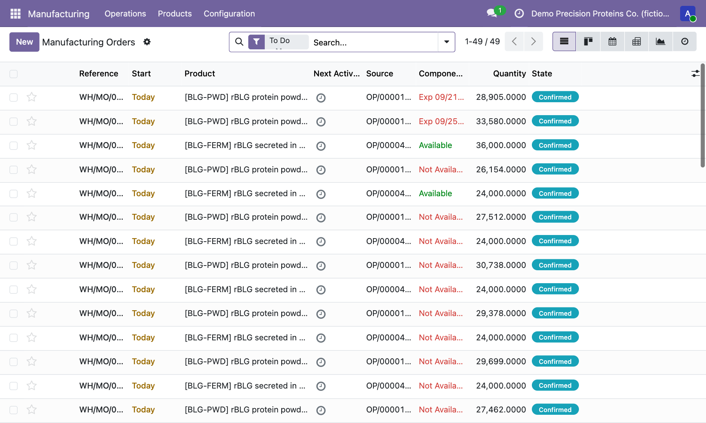
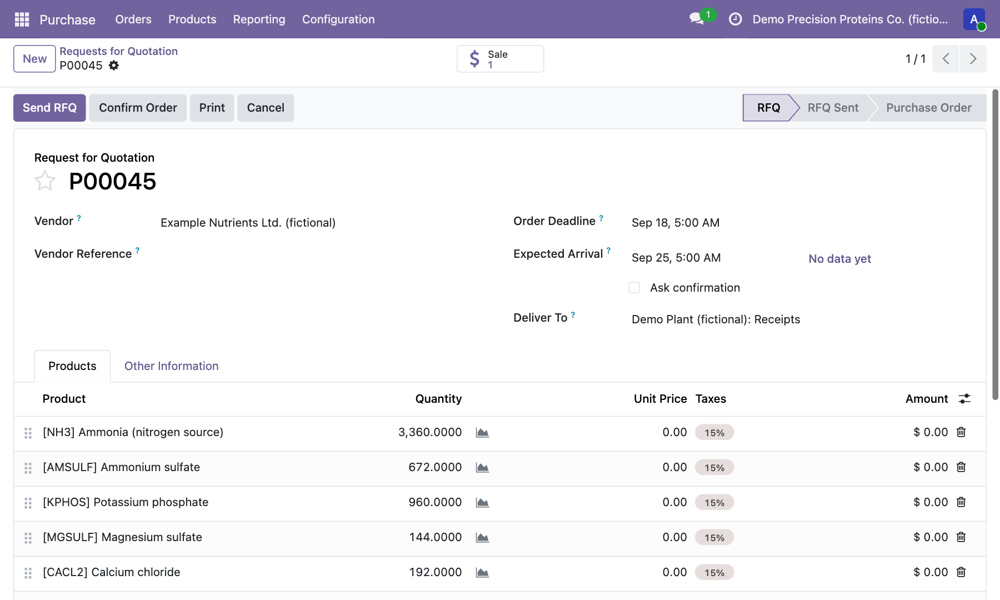
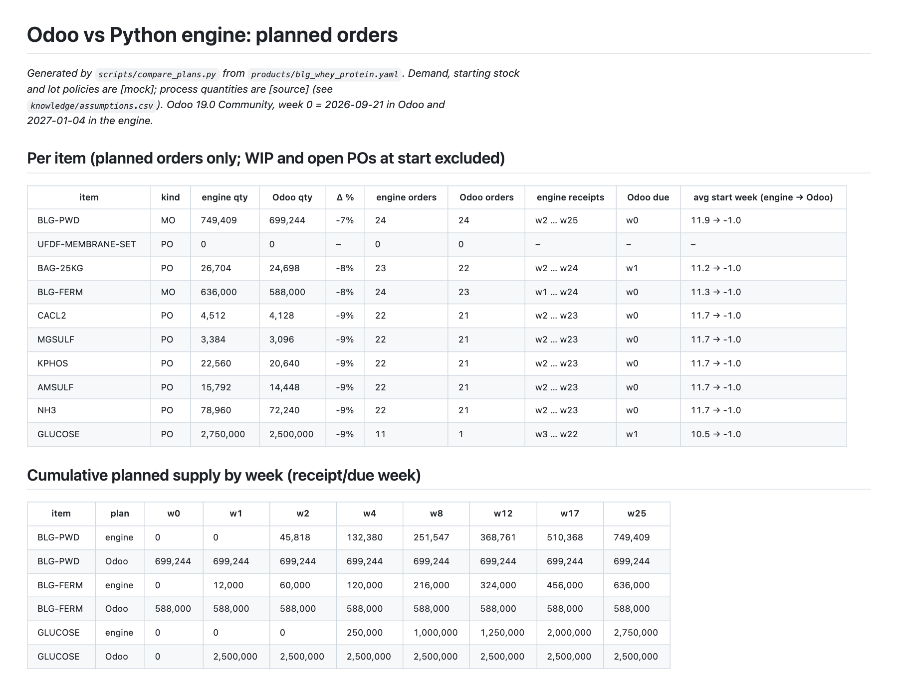

# Supply Chain Planning

**The problem:** a manufacturer has to turn a demand forecast into a plan it can actually
run: how much to make each week, which materials to buy and from whom, and whether the
plant has the capacity. Then it has to execute that plan in an ERP and measure how it went.

**What I built:** an end-to-end planning system for a mock precision-fermentation plant
making whey protein:
- **Python planning engine:** S&OP → MPS → MRP → rough-cut capacity → purchasing →
  supplier sourcing. Product-agnostic: each product is one config file.
- **Odoo 19 ERP:** the same plant as products, BOMs, vendors, reorder rules,
  manufacturing and purchase orders, seeded by script and compared with the engine.
- **In progress:** Odoo becomes the system of record (my own transactions plus scripted
  history), feeding a KPI dashboard (see [status](docs/status.md)).

**What it shows** [estimate, mock demand]:
- Leveling fermentation batches cuts peak fermenter load from **119% to 89%** of capacity.
- The cheapest supplier quote is **not** the lowest total cost on **9 of 9** purchased
  items, once freight, duty, MOQ carrying cost and quality are counted.
- Odoo's reorder rules and the engine's MRP agree on quantities within **7–9%**, but
  Odoo orders the whole 26-week need up front while MRP phases it week by week
  ([comparison](docs/odoo/comparison.md)).

**Integrity rules:** no personal information and no company's internal data. Every
number lives in [`knowledge/assumptions.csv`](knowledge/assumptions.csv), labeled
`cited` (public source + locator), `estimate` or `mock`, and the loader rejects
process math resting on anything uncited. Demand is mock. Feedstock prices are real
(IMF series via FRED).

**Jump to:** [Hands-on ERP](#hands-on-erp) · [Sourcing](#sourcing) ·
[Case 1 at a glance](#case-1-at-a-glance-per-kg-of-powder) ·
[Decisions (ADRs)](docs/decisions/) · [How this was built](#how-this-was-built) ·
[Changelog](CHANGELOG.md)

## Status

| Milestone | Scope | State |
|---|---|---|
| **M1** | FRED data pull, mock demand generator, BOM, basic MRP table | ✅ done |
| **M2** | S&OP (monthly, aggregate) → MPS (weekly), ATP, time fences | ✅ done |
| **M3** | Purchasing: PO schedule, feedstock spend vs. FRED history, price scenarios | ✅ done |
| **M4** | RCCP: batch starts vs. reactors, pull-forward leveling | ✅ done (fermenters; DSP throughput still unsourced) |
| **M5** | Static chart report (local HTML: S&OP, MPS, RCCP, purchasing, feedstock cost) | ✅ done (public version: see status) |
| **M6** | Sourcing: supplier master, should-cost, RFQ scoring and award, TCO, supplier scorecard, single/dual source and forward-buy scenarios | ✅ done (Odoo mirror verified) |
| **ERP** | Case 1 in Odoo 19 Community: BOM → reorder rules → MO/PO, compared with the engine | ✅ built |

Details: [`docs/status.md`](docs/status.md) · map of all docs: [`INDEX.md`](INDEX.md).

## Quick start

```bash
python3 -m venv .venv && .venv/bin/pip install -e ".[dev]"
.venv/bin/pytest
.venv/bin/python scripts/fetch_data.py                     # FRED → data/raw/ (not committed)
.venv/bin/python -m ppsim run products/blg_whey_protein.yaml
.venv/bin/python -m ppsim run products/blg_whey_protein.yaml --variant sucrose
make report      # outputs/report/index.html: 13 interactive static charts, opens in any browser
```

Outputs go to `outputs/<product>[-<variant>]/`: `demand_mock.csv`, `sop_plan.csv`,
`mps_<ITEM>.csv`, `rccp_load.csv`, `po_schedule.csv`,
`spend_by_scenario.csv`, `bom_explosion.csv`, `mrp_<ITEM>.csv`, `mrp_long.csv`, `parameters.csv` (every number
used, with status and citation), `feedstock_*.csv`, the sourcing set
(`sourcing_should_cost.csv`, `sourcing_quotes_scored.csv`, `sourcing_awards.csv` with a
written rationale per item, `sourcing_tco.csv`, `supplier_scorecard.csv`,
`sourcing_strategy.csv`, `sourcing_forward_buy.csv`), and `manifest.json`.

## How it works

```
knowledge/assumptions.csv ─► config loader ─► mock demand ─► S&OP ─► MPS ─► MRP ─► outputs/*.csv ─► static charts
products/<id>.yaml ─────────┘  (rejects uncited     (monthly)  (weekly,         ▲
                                process numbers)                fences, ATP)     │
FRED CSV ─► data/raw/ ─► feedstock prices ─► cost per kg ────────────────────────┘
```

- **Engine** (`src/ppsim/`): pure Python + pandas, no plotting or UI imports.
- **Configs** (`products/<id>.yaml`): items, BOM, policies and demand spec, written as
  *assumption ids*, never raw numbers. BOM quantities are expressions over `cited`
  ids, and the loader enforces that.
- **MRP:** gross → net → lot-size (lot-for-lot, fixed order quantity, periods of supply,
  min/multiple) → lead-time offset, in low-level-code order, with safety stock and
  past-due flags.

More: [`docs/architecture.md`](docs/architecture.md), and the decisions in
[`docs/decisions/`](docs/decisions/).

## Sourcing

The planning engine decides how much to buy and when. **M6 decides who from and at what
cost**, which is the half that a buyer or sourcing analyst is actually measured on.

| Step | What it produces |
|---|---|
| **Supplier master** | every bidder per purchased item: lane, incoterm, risk tier, quoted price, lead time, MOQ, defect ppm, OTIF |
| **Should-cost** | material (cited commodity index where one is linked, else a labelled mock base) + conversion + margin = target price, and the gap to each quote |
| **RFQ → award** | price / lead time / quality / risk, range-normalised inside the bid set and weighted by policy, with a one-sentence rationale naming the criterion that decided it |
| **Total cost of ownership** | quote + freight and duty **by incoterm** + carrying cost of the MOQ + cost of defects. In case 1 the cheapest quote on every item is an import bid, and it loses on total cost every time |
| **Supplier scorecard** | a simulated delivery history gives OTIF, fill rate, lead-time variance and purchase price variance against standard cost |
| **Category strategy** | single vs dual source priced against the expected value of supply at risk; the safety-stock cost of an erratic lead time; forward buy vs spot through the p10/p50/p90 price scenarios |

Suppliers, quotes and performance are **fictional and [mock]**, and every output says
so; commodity prices stay cited. Concepts and vocabulary:
[`knowledge/topics/sourcing-concepts.md`](knowledge/topics/sourcing-concepts.md).

## Case 1 at a glance (per kg of powder)

| Step | Quantity | Basis |
|---|---|---|
| rBLG secreted in fermentation | 0.880 kg | 85.8 % rBLG in product ÷ 97.5 % MF recovery [source → derived] |
| Glucose (or sucrose) fed | 4.38 kg | 0.223 g protein/g sugar, 90 % rBLG share [source → derived] |
| Corn, as glucose feedstock | ≥ 7.05 kg | EPA AP-42 starch yield + hydrolysis stoichiometry [source → derived] |

Process background: [`knowledge/topics/precision-fermentation-process.md`](knowledge/topics/precision-fermentation-process.md).

## Hands-on ERP

Case 1 also runs in **Odoo 19 Community** (local Docker). It's seeded from the same
`product.yaml` through Odoo's JSON-2 API, so there's no manual data entry and the
company, vendors and customer are fictional. One command rebuilds it from scratch:

```bash
make odoo-demo    # reset → up → init → seed → run scheduler → compare (~1 min)
```

Odoo covers the transaction flow: products, per-batch BOMs, vendor price lists (one line
per bidder, the awarded supplier first), the RFQ round as draft purchase orders,
reorder rules, replenishment runs, and the MOs and POs they generate. Two things the
sourcing build only learned by running it: a **draft RFQ already counts as replenishment
in progress**, so a bid round seeded before the scheduler stops it raising any PO at
all; and **vendor selection respects the minimum order quantity**, so awarding the
cheapest bid to a supplier asking six weeks of cover means weekly orders quietly go to
the runner-up instead. S&OP, the MPS
and capacity stay in the Python engine, because they're Enterprise-only in Odoo
(ADR 0009). The [comparison](docs/odoo/comparison.md) shows the key difference:
reorder rules replenish the whole 26-week window **now**, while the engine's MRP
releases each order in the week it's needed. Quantities agree to within 7–9 %, and
that gap is the engine's S&OP inventory build. Details and lessons:
[`docs/odoo/README.md`](docs/odoo/README.md).

| Bill of materials (one 12,000 kg batch) | Reorder rules |
|---|---|
|  |  |
| **Replenishment run: MOs all start today** | **A generated MO (3-batch multiple)** |
|  |  |
| **A generated RFQ (fictional vendor)** | **Odoo vs engine comparison** |
|  |  |

## How this was built

I designed this project and made the decisions; I wrote the code with
[Claude Code](https://claude.com/claude-code) as a pair programmer. Concretely:

- **I set the scope and the rules:** which planning steps to model, which public sources
  are acceptable, that demand stays mock, and that no employer or personal data enters
  the repo.
- **Every design choice is recorded** as an [ADR](docs/decisions/) (context, decision,
  alternatives, consequences). That's where my reasoning is, in my words.
- **Numbers are verified, not assumed:** parameters trace to cited sources or carry a
  `mock` label, the engine has 170 hand-checkable tests, and the Odoo demo is checked
  against the engine's own MRP.
- **Guardrails are automated:** `scripts/pre_push_check.py` runs the tests, audits
  citations, and blocks pushes containing personal emails, phone numbers, API keys,
  private terms or non-noreply commit identities.
- **The AI workflow is part of the repo:** [`CLAUDE.md`](CLAUDE.md) and the skills
  in `.claude/skills/` are the instructions I gave it; commits it co-wrote carry a
  `Co-Authored-By: Claude` trailer.

## Data sources and licensing

- Behm et al. (2022), *Int J Life Cycle Assess* 27:1017–1034, CC BY 4.0.
- US EPA AP-42 §9.9.7 Corn Wet Milling.
- IMF Primary Commodity Prices via FRED: `PMAIZMTUSDM`, `PSUGAISAUSDM`. These are
  copyrighted by the IMF and must be cited. They're fetched at runtime and not
  redistributed here (see `scripts/fetch_data.py`).

## License

- **Code** (everything outside `docs/` and `knowledge/`): [MIT](LICENSE).
- **Documentation and research content** (`docs/`, `knowledge/`):
  [CC BY 4.0](LICENSE-docs). Reuse is welcome with attribution to
  *ariel-salvador, supply-chain-planning*.
- **Third-party material is not covered by either license.** Cited papers, EPA
  documents and the IMF/FRED price series keep their own terms. The price data is
  not redistributed here, and published charts must cite "International Monetary
  Fund, retrieved from FRED, Federal Reserve Bank of St. Louis."
