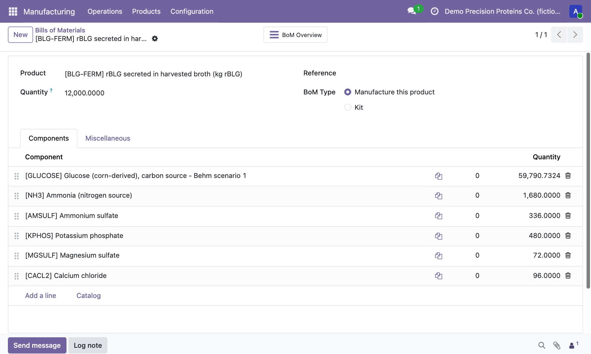
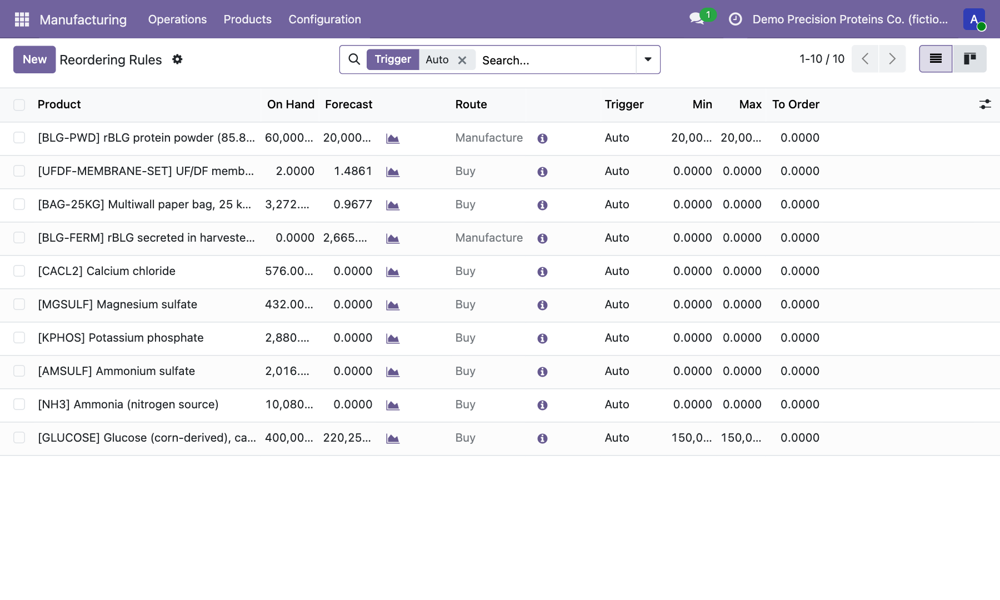
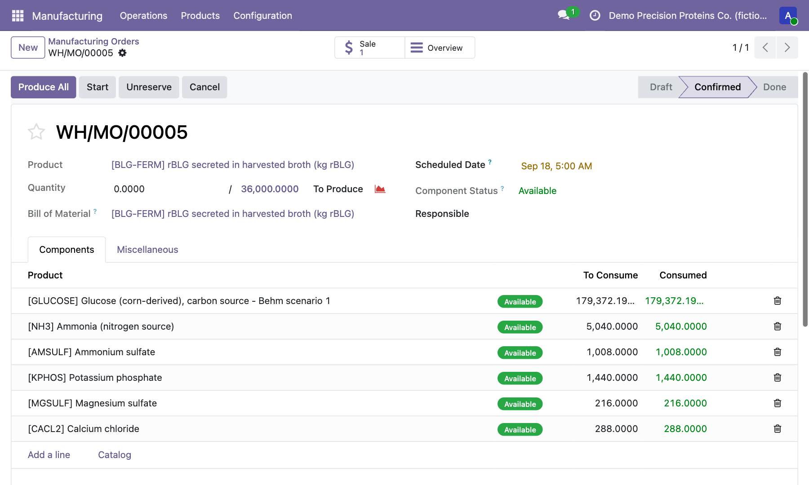

# Production Planning Simulator

A product-agnostic production planning engine covering
**S&OP → MPS → MRP → purchasing → rough-cut capacity planning (RCCP)**. Each product is
one config file.

**Case 1:** a *mock* precision-fermentation plant making recombinant
beta-lactoglobulin (rBLG) whey protein powder. The feedstock prices are real (IMF
commodity series via FRED), the process parameters are cited from public literature,
and **the demand is mock**.

> Portfolio project. No personal information and no company's internal data. Every
> model number lives in [`knowledge/assumptions.csv`](knowledge/assumptions.csv) with
> its status (`cited` / `estimate` / `mock`), source and retrieval date.

## Status

| Milestone | Scope | State |
|---|---|---|
| **M1** | FRED data pull, mock demand generator, BOM, basic MRP table | ✅ done |
| **M2** | S&OP (monthly, aggregate) → MPS (weekly), ATP, time fences | ✅ done |
| M3 | Purchasing: PO schedule, feedstock spend vs. FRED history, price scenarios | planned |
| **M4** | RCCP: batch starts vs. reactors, pull-forward leveling | ✅ done (fermenters; DSP throughput still unsourced) |
| M5 | Static charts (published first), then an optional interactive UI | planned |
| **ERP** | Case 1 in Odoo 19 Community: BOM → reorder rules → MO/PO, compared with the engine | ✅ built |

Details: [`docs/status.md`](docs/status.md) · map of all docs: [`INDEX.md`](INDEX.md).

## Quick start

```bash
python3 -m venv .venv && .venv/bin/pip install -e ".[dev]"
.venv/bin/pytest
.venv/bin/python scripts/fetch_data.py                     # FRED → data/raw/ (not committed)
.venv/bin/python -m ppsim run products/blg_whey_protein.yaml
.venv/bin/python -m ppsim run products/blg_whey_protein.yaml --variant sucrose
```

Outputs go to `outputs/<product>[-<variant>]/`: `demand_mock.csv`, `sop_plan.csv`,
`mps_<ITEM>.csv`, `bom_explosion.csv`, `mrp_<ITEM>.csv`, `mrp_long.csv`, `parameters.csv` (every number
used, with status and citation), `feedstock_*.csv`, and `manifest.json`.

## How it works

```
knowledge/assumptions.csv ─► config loader ─► mock demand ─► S&OP ─► MPS ─► MRP ─► outputs/*.csv ─► static charts
products/<id>.yaml ─────────┘  (rejects uncited     (monthly)  (weekly,         ▲
                                process numbers)                fences, ATP)     │
FRED CSV ─► data/raw/ ─► feedstock prices ─► cost per kg ────────────────────────┘
```

- **Engine** (`src/ppsim/`): pure Python + pandas, no plotting or UI imports.
- **Configs** (`products/<id>.yaml`): items, BOM, policies and demand spec, written as
  *assumption ids*, never raw numbers. BOM quantities are expressions over `cited`
  ids, and the loader enforces that.
- **MRP:** gross → net → lot-size (lot-for-lot, fixed order quantity, periods of supply,
  min/multiple) → lead-time offset, in low-level-code order, with safety stock and
  past-due flags.

More: [`docs/architecture.md`](docs/architecture.md), and the decisions in
[`docs/decisions/`](docs/decisions/).

## Case 1 at a glance (per kg of powder)

| Step | Quantity | Basis |
|---|---|---|
| rBLG secreted in fermentation | 0.880 kg | 85.8 % rBLG in product ÷ 97.5 % MF recovery [source → derived] |
| Glucose (or sucrose) fed | 4.38 kg | 0.223 g protein/g sugar, 90 % rBLG share [source → derived] |
| Corn, as glucose feedstock | ≥ 7.05 kg | EPA AP-42 starch yield + hydrolysis stoichiometry [source → derived] |

Process background: [`knowledge/topics/precision-fermentation-process.md`](knowledge/topics/precision-fermentation-process.md).

## Hands-on ERP

Case 1 also runs in **Odoo 19 Community** (local Docker). It's seeded from the same
`product.yaml` through Odoo's JSON-2 API, so there's no manual data entry and the
company, vendors and customer are fictional. One command rebuilds it from scratch:

```bash
make odoo-demo    # reset → up → init → seed → run scheduler → compare (~1 min)
```

Odoo covers the transaction flow: products, per-batch BOMs, vendor lead times,
reorder rules, replenishment runs, and the MOs and RFQs they generate. S&OP, the MPS
and capacity stay in the Python engine, because they're Enterprise-only in Odoo
(ADR 0009). The [comparison](docs/odoo/comparison.md) shows the key difference:
reorder rules replenish the whole 26-week window **now**, while the engine's MRP
releases each order in the week it's needed. Quantities agree to within 7–9 %, and
that gap is the engine's S&OP inventory build. Details and lessons:
[`docs/odoo/README.md`](docs/odoo/README.md).

| Bill of materials (one 12,000 kg batch) | Reorder rules |
|---|---|
|  |  |
| **Replenishment run: MOs all start today** | **A generated MO (3-batch multiple)** |
|  |  |
| **A generated RFQ (fictional vendor)** | **Odoo vs engine comparison** |
|  |  |

## Data sources and licensing

- Behm et al. (2022), *Int J Life Cycle Assess* 27:1017–1034, CC BY 4.0.
- US EPA AP-42 §9.9.7 Corn Wet Milling.
- IMF Primary Commodity Prices via FRED: `PMAIZMTUSDM`, `PSUGAISAUSDM`. These are
  copyrighted by the IMF and must be cited. They're fetched at runtime and not
  redistributed here (see `scripts/fetch_data.py`).

## License

- **Code** (everything outside `docs/` and `knowledge/`): [MIT](LICENSE).
- **Documentation and research content** (`docs/`, `knowledge/`):
  [CC BY 4.0](LICENSE-docs). Reuse is welcome with attribution to
  *agenttofu0, production-planning-simulator*.
- **Third-party material is not covered by either license.** Cited papers, EPA
  documents and the IMF/FRED price series keep their own terms. The price data is
  not redistributed here, and published charts must cite "International Monetary
  Fund, retrieved from FRED, Federal Reserve Bank of St. Louis."
